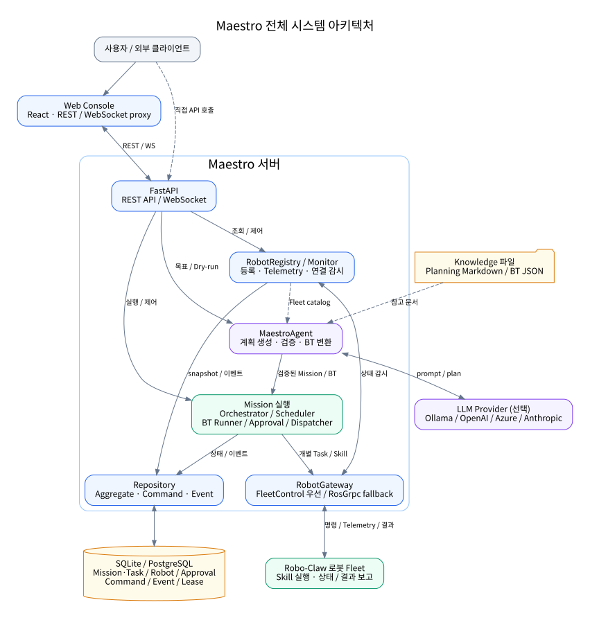
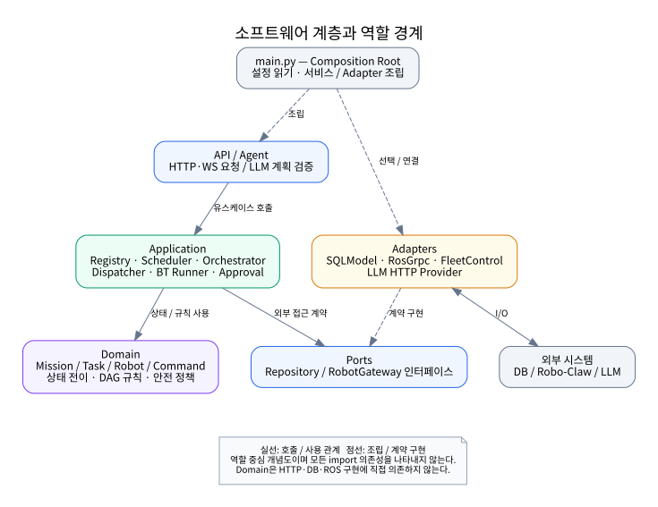
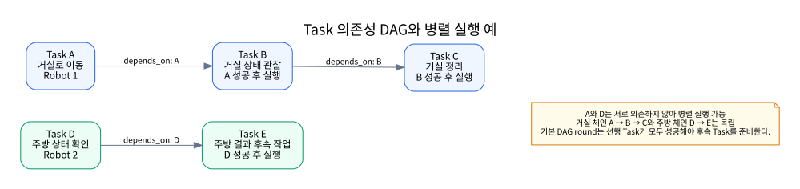
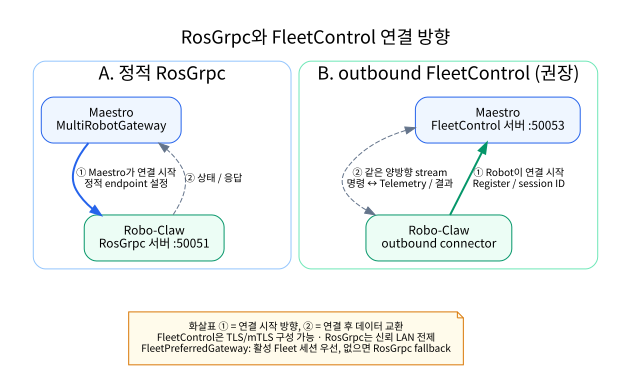
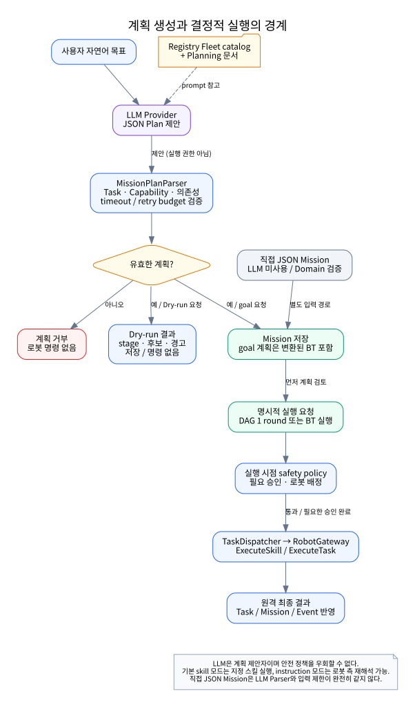
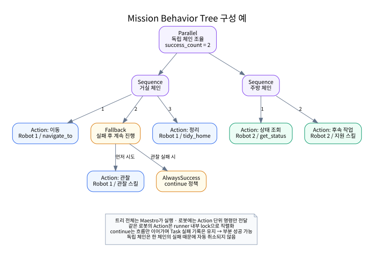
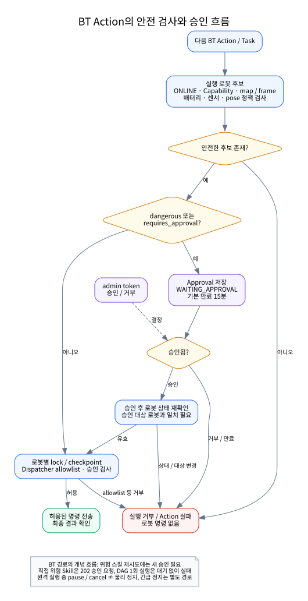
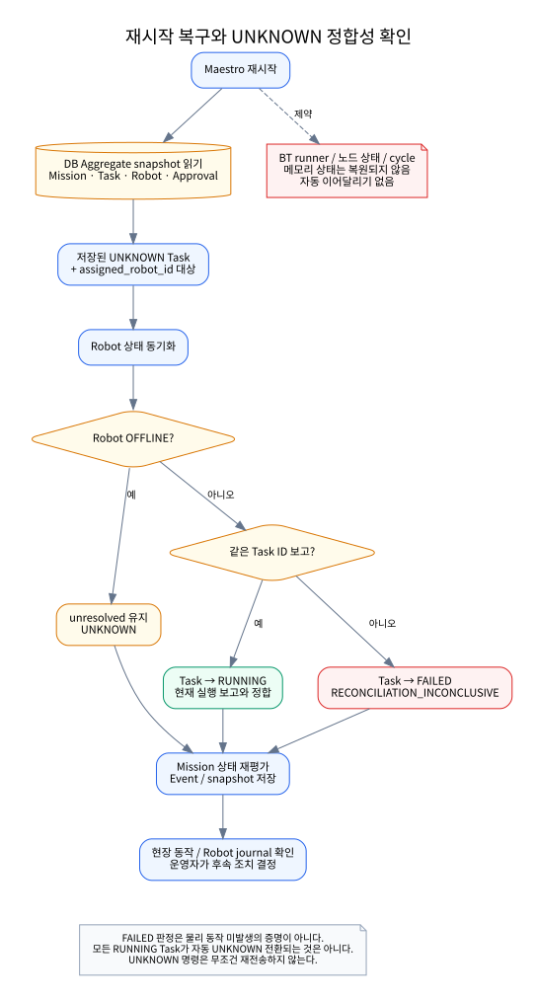

# Robo-Claw Maestro 기술 문서

| 항목 | 내용 |
| --- | --- |
| 문서 버전 | 0.2 |
| 문서 상태 | 기술 검토용 초안 |
| 작성자 | 구세완 & GPT-6.1-sol |
| 작성일 | 2026-11-09 (KST) |
| 대상 소프트웨어 | Robo-Claw Maestro |
| 대상 소프트웨어 버전 | Backend 패키지·Web Console·FastAPI 선언 버전 `0.1.0` |
| 기준 커밋 | `b8d9b754ca0b15a589cf65da8bf642383158819e` (`b8d9b75`) |
| 기준 커밋 일자 | 2026-11-07 |
| 기준 커밋 제목 | `feat(web): 로봇 capability를 분류별 접기/펼치기 트리로 표시` |

> 이 문서는 기준 커밋의 소스 코드와 저장소 문서를 조사하여 작성했다. `0.1.0`은 파일에 선언된 버전이며, 정식 릴리스나 실기기 인수 완료를 의미하지 않는다. 코드 구현, 기존 검증 기록, 향후 목표를 구분한다. 실제 로봇의 동작·안전성은 해당 Robo-Claw 버전과 현장 환경에서 별도로 검증해야 한다.

## 차례

1. 개요
2. 시스템 아키텍처
3. 핵심 도메인과 데이터 모델
4. 로봇 연결과 통신
5. 작업 계획과 실행
6. 안전성과 제어 정책
7. API와 외부 인터페이스
8. Web Console
9. 설치와 환경 설정
10. 운영과 장애 대응
11. 테스트와 검증
12. 구현 현황과 확장 계획

부록: 환경 변수, API·이벤트·프로토콜, 작성 예제, 상태 전이·시퀀스, 용어·참고 문서

## 1. 개요

### 1.1 Maestro의 목적과 주요 기능

Robo-Claw Maestro는 여러 Robo-Claw 로봇을 중앙에서 모니터링하고, 사용자 목표를 Mission과 Task로 분해하여 로봇에 배정하는 Fleet 오케스트레이션 서비스다. 로봇의 개별 자율 실행을 대체하는 것이 아니라, 여러 로봇 사이의 작업 순서·배정·진행 상태를 조율한다.

주요 기능은 로봇 등록과 Telemetry 수집, 자연어 계획 생성, 계획 검증, Capability 기반 작업 배정, 순차·병렬 실행, Behavior Tree 실행, 승인 절차, 긴급 정지, 실행 이력 조회다. LLM을 사용하지 않아도 로봇 조회, 직접 Mission 생성·실행, 긴급 정지를 사용할 수 있다.

### 1.2 적용 시나리오: 다중 로봇 관리와 작업 오케스트레이션

대표 시나리오는 여러 구역의 병렬 점검, 이동 후 관찰·정리 같은 단계형 작업, 로봇별 역할을 구분한 협업, 일정 간격으로 반복하는 작업이다. 예를 들어 한 로봇은 거실로 이동하여 정리하고, 다른 로봇은 독립적으로 주방 상태를 확인할 수 있다.

실행 가능한 목표는 등록된 로봇의 스킬과 실제 동작 범위에 의해 제한된다. 계획을 생성했다는 사실만으로 물리적으로 수행 가능하거나 안전하다고 판단해서는 안 된다.

### 1.3 Robo-Claw 및 Config Server와의 관계

| 시스템 | 역할 |
| --- | --- |
| Maestro | Fleet 상태 관리, 계획 검증, 로봇 배정, Mission 실행 조율, 관제 UI |
| Robo-Claw | 로봇 현장에서 Task 또는 Skill 실행, 로봇 내부 제어와 결과 보고 |
| AI Config Server | Robot 프로필과 실행 환경 설정 관리. FleetControl 연결 설정 입력 경로 제공 |

FleetControl 방식에서는 Robot 프로필에 Maestro 주소, 포트, 고유 Robot ID 등을 설정한다. 실제 연결과 상태·결과 교환은 Robo-Claw connector와 Maestro 사이에서 이루어진다. Config Server는 Maestro의 작업 실행 엔진이 아니다.

### 1.4 문서 범위와 대상 독자

이 문서는 Maestro 개발자, 로봇 연동 담당자, 시스템 운영자, 기술 검토자를 대상으로 한다. 시스템 구조, 주요 모델, 실행 방식, 외부 인터페이스, 설치, 장애 대응, 검증 기준을 설명한다.

로봇 하드웨어 제어, ROS 2 내부 구성, 로봇별 스킬 구현, Config Server 전체 API는 범위 밖이다. 해당 항목은 각 저장소 문서와 함께 확인한다. 본문의 파일 경로는 별도 표시가 없으면 Maestro 저장소 루트 기준이다.

### 1.5 주요 용어: Fleet, Robot, Mission, Task, Capability

- **Fleet**: Maestro가 관리하는 로봇 집합.
- **Robot**: 고유 ID, 연결 상태, 배터리, 위치, Capability 등을 가진 관리 대상.
- **Mission**: 사용자 목표와 이를 수행하는 Task 집합 및 실행 제약.
- **Task**: 특정 작업의 실행 단위. 스킬 호출 또는 자연어 지시를 담는다.
- **Capability**: 로봇이 보고하는 수행 능력. 이름뿐 아니라 버전, 위험 수준, 요구 센서, 입력 스키마를 포함할 수 있다.
- **Command**: 특정 Task의 실행 시도를 로봇에 전달하기 위한 식별·전송 단위.

## 2. 시스템 아키텍처

### 2.1 전체 시스템 구성도



*그림 1. 사용자·Console·API·계획·실행·저장소·로봇 Fleet 사이의 주요 데이터 흐름. 화살표는 역할 중심의 연결을 나타내며 개별 함수 호출 순서는 아니다.*

> 그림은 SVG로 삽입했다. 편집 가능한 Graphviz DOT 원본과 재생성 방법은 [diagrams/README.md](diagrams/README.md)에 정리했다. SVG는 브라우저와 VS Code Markdown 미리보기에서 확인할 수 있다.

Console 없이 REST API로도 사용할 수 있다. LLM은 계획 생성 경계에서 사용하며, 검증된 계획의 실행은 애플리케이션 서비스가 담당한다.

### 2.2 주요 구성 요소와 역할

코드는 Domain, Application, Ports, Adapters로 관심사를 분리한다.

| 경로 / 구성 요소 | 책임 |
| --- | --- |
| `src/robo_claw_maestro/domain/` | Robot·Mission·Task·Command·Approval·Resource 모델과 상태 규칙 |
| `application/robot_registry.py` | 로봇 등록, 상태 갱신, Heartbeat, 긴급 정지 |
| `application/robot_monitor.py` | 상태 stream 감시와 재연결 |
| `application/scheduler.py` | 안전 조건 평가와 결정적 로봇 선정 |
| `application/mission_orchestrator.py` | Mission 생명주기, DAG scheduling round, 상태·이벤트 저장 |
| `application/task_dispatcher.py` | Command 생성, Skill/Task 전송, 원격 결과 매핑 |
| `application/bt_runner.py` | Mission Behavior Tree 실행, 노드 상태, 승인 대기, 후속 작업 |
| `application/approval_service.py` | 위험 스킬과 Mission Task의 승인 처리 |
| `agent/` | LLM 계획 파싱, Fleet catalog, Planning 문서, BT 변환 |
| `ports/` | Repository와 RobotGateway 인터페이스 |
| `adapters/` | DB, gRPC, LLM Provider 구현 |
| `api/` | REST와 WebSocket 제공 |
| `main.py` | 설정을 읽고 구성 요소를 조립하는 진입점 |

Domain은 API·DB·ROS 구현에 직접 의존하지 않도록 설계되어 있다. 테스트에서는 실제 Adapter 대신 fake와 in-memory Repository를 사용할 수 있다.



*그림 2. Composition Root, 진입 계층, Application, Domain, Ports, Adapters의 역할. 실선은 사용·호출 관계, 점선은 조립·계약 구현 관계를 나타낸다. 전체 import 의존성 그래프는 아니다.*

### 2.3 Backend, Web Console, 데이터베이스 구성

Backend는 Python 3.11 이상 3.13 미만, FastAPI, Pydantic, gRPC, SQLModel, Alembic을 사용한다. Dockerfile의 실행 환경은 `python:3.11-slim`이다. Web Console은 React·TypeScript·Vite로 개발하며 배포 시 Nginx를 사용한다.

개발 기본 DB는 SQLite이고, Docker Compose는 PostgreSQL 16을 사용한다. DB에는 Mission과 그 안의 Task, Robot snapshot, Command, Approval, Resource lease, Event가 저장된다. BT 문서와 Planning 문서는 DB가 아니라 Knowledge 디렉터리에 저장한다.

### 2.4 로봇 통신 구조: RosGrpc와 FleetControl

| 구분 | RosGrpc | FleetControl |
| --- | --- | --- |
| 연결 방향 | Maestro → 로봇 | 로봇 → Maestro |
| 등록 방식 | `MAESTRO_ROBOTS_JSON` 정적 endpoint | stream 첫 메시지 `Register` |
| 대표 포트 | 로봇 측 `50051` | Maestro 측 `50053` |
| Capability | 정적 설정의 보조 입력 사용 | 로봇 등록 시 구조화 정보 보고 |
| 보안 | 현재 연동은 신뢰할 수 있는 LAN 전제 | TLS/mTLS 구성 가능 |
| 적용 | 기존 RosGrpc 연동, 고정 소규모 구성 | 동적 등록과 다중 로봇 운영 |

두 경로를 함께 구성할 수 있다. `FleetPreferredGateway`는 연결된 FleetControl 세션이 있으면 해당 경로를 우선하고, 없으면 RosGrpc 경로를 사용한다.

### 2.5 명령·상태·이벤트 데이터 흐름

1. 로봇 등록 또는 정적 설정으로 Registry에 로봇을 확보한다.
2. Telemetry를 받아 연결 상태, 배터리, 위치, 작업 상태를 저장한다.
3. 사용자 목표를 계획으로 변환하거나 JSON Mission을 생성한다.
4. 계획 검증과 실행 시점 안전 정책을 적용한다.
5. Task를 배정하고 Command 식별자를 생성한 뒤 로봇에 전송한다.
6. 최종 실행 결과를 Task와 Mission 상태에 반영한다.
7. 상태 변경·배정·승인 등의 이벤트를 저장하고 Console에 전달한다.

현재 Aggregate 저장과 Event append는 항상 하나의 DB 트랜잭션으로 묶이지 않는다. 따라서 이를 완전한 Event Sourcing 또는 원자적 Audit 시스템으로 설명해서는 안 된다.

## 3. 핵심 도메인과 데이터 모델

### 3.1 Robot 등록 정보와 상태

Robot은 `robot_id`, 표시 이름, 로봇 유형, 소프트웨어·프로토콜 버전, `site_id`, `map_id`, `map_version`, `frame_id`, `session_id`를 가진다. 실행 상태로는 최근 관측 시각, 배터리, 위치, health issues, 현재 Task·Skill, queue depth 등을 유지한다.

연결 상태는 `UNKNOWN`, `ONLINE`, `DEGRADED`, `OFFLINE`, `ESTOPPED`이며, 운용 상태는 `UNKNOWN`, `IDLE`, `THINKING`, `EXECUTING`, `WAITING`, `ERROR`다. 연결되어 있다는 사실과 작업을 수행 중이라는 사실은 별개로 표시한다.

Capability는 이름을 키로 관리한다. `risk_level`, `requirements`, `input_schema`는 정책과 입력 설명에 사용되지만, 임의 스킬의 모든 인자를 범용적으로 검증한다는 보장은 없다.

### 3.2 Mission·Task 모델과 생명주기

Mission은 목표, 우선순위, 작성 주체, 계획 버전, Task 집합, `constraints`, 요약, 시작·종료 시각을 포함한다.

| Mission 상태 | 의미 |
| --- | --- |
| `DRAFT`, `PLANNING`, `READY` | 작성, 계획 중, 실행 준비 |
| `RUNNING`, `PAUSED` | 실행 중, 다음 진행 일시정지 |
| `SUCCEEDED` | 전체 성공 |
| `PARTIALLY_SUCCEEDED` | 일부 성공과 실패·미실행 등이 혼재 |
| `FAILED` | 성공 없이 실패 등으로 종료 |
| `CANCEL_REQUESTED`, `CANCELLED` | 취소 요청 중, 취소 종료 |

Task는 지시문, `skill_name`, `params`, 필요 Capability, 의존 Task, 지정 로봇, timeout, retry budget, 시도 이력, 결과·오류를 가진다. 주요 실행 흐름은 `CREATED → READY → ASSIGNED → ACCEPTED → RUNNING → SUCCEEDED/FAILED`다. `BLOCKED`, `QUEUED`, `CANCEL_REQUESTED`, `CANCELLED`, `TIMED_OUT`, `UNKNOWN`도 지원한다.

상태 전이는 Domain에서 허용 목록으로 검사한다. 실제 Adapter가 모든 중간 상태를 실시간으로 노출하는 것은 아니다. 예를 들어 현재 Dispatcher의 `ACCEPTED` 전이는 원격 ACK와 일대일로 연결된 상태 표시가 아니다.

### 3.3 Task 의존성 및 병렬 실행 구조

Mission의 `depends_on`은 DAG(방향성 비순환 그래프)를 만든다. 없는 Task 참조, 자기 참조, 중복 Task ID, 의존성 순환은 검증 오류다. 순환 검사는 Kahn 알고리즘으로 수행한다.

기본 DAG 실행에서 선행 Task가 모두 성공한 Task만 준비 대상이 된다. 독립 Task는 같은 round에서 병렬 배정할 수 있으며, 로봇 한 대에는 round당 최대 하나를 배정한다. BT의 `continue` 정책은 이 기본 DAG 규칙과 구별되는 실행 제어다.



*그림 3. 거실 작업 A→B→C와 주방 작업 D→E의 독립 체인 예. A와 D는 동시에 실행할 수 있지만 각 체인의 후속 Task는 선행 성공을 기다린다. 작업 이름과 로봇은 설명용 예시다.*

### 3.4 Command 식별과 중복 실행 방지

각 실행 시도에는 `command_id`, `attempt_id`, `correlation_id`, `idempotency_key`가 포함된다. 기본 idempotency key 형식은 다음과 같다.

```text
<mission_id>:<task_id>:<robot_id>:<attempt>
```

반복 사이클에는 `:c<n>`, 운영자 재실행에는 `:r<n>`을 추가한다. 의도한 신규 실행과 같은 명령의 재전송을 구별하기 위해서다. Maestro의 `commands.idempotency_key`는 DB unique 제약으로 중복 저장을 방지한다.

전달 설계는 at-least-once와 중복 제거를 전제로 한다. 로봇 측에서도 결과를 영속 저장하고 같은 key에 대해 물리 동작 없이 기존 결과를 반환해야 한다. 네트워크와 물리 실행을 아우르는 exactly-once 보장은 없다.

### 3.5 이벤트·실행 결과·이력 저장

SQLModel Adapter는 Aggregate를 JSON payload로 저장한다. 별도 `tasks` 테이블 대신 Mission payload 내부에 Task 목록을 보관한다.

| 테이블 | 저장 내용 |
| --- | --- |
| `missions` | Mission과 Task snapshot |
| `robots` | 등록·운용 상태 snapshot |
| `commands` | Command 식별 및 payload |
| `approvals` | 승인 상태, 시각, payload, 결과 |
| `resource_leases` | 자원별 owner와 만료 시각 |
| `events` | Aggregate ID, 발생 시각, 이벤트 payload |

Task 결과에는 스킬 출력과 오류 코드·메시지가 들어간다. Command 모델에는 전달 상태 열거형이 있지만, 현재 이를 완전한 전송 상태 Ledger로 자동 갱신한다고 가정해서는 안 된다. 운영 상태 판단은 Task·Mission, 로봇 Telemetry, 이벤트를 함께 사용한다.

## 4. 로봇 연결과 통신

### 4.1 정적 RosGrpc 연결 방식

`MAESTRO_ROBOTS_JSON`에 로봇 ID, endpoint, Capability 등을 선언하면 `MultiRobotGateway`가 로봇별 RosGrpc 연결을 구성한다. endpoint는 로봇의 gRPC 주소이며 Maestro HTTP 주소가 아니다.

```dotenv
MAESTRO_ROBOTS_JSON=[{"robot_id":"robot-1","endpoint":"192.168.0.101:50051","capabilities":["get_status","navigate_to"]}]
```

이 값은 구성 예시이며 실제 주소와 스킬로 교체해야 한다. 정적 RosGrpc 연동은 현재 신뢰할 수 있는 개발 LAN에서 사용한다. 인터넷에 직접 노출하지 않는다.

### 4.2 로봇 outbound FleetControl 연결 방식

Robot이 Maestro의 전용 gRPC 포트에 양방향 stream을 연결한다. 첫 메시지는 `Register`여야 하며, Maestro는 프로토콜 버전과 Robot identity를 검사한 뒤 `RegistrationResult`를 반환한다.

```protobuf
service FleetControl {
  rpc Connect(stream RobotToMaestro) returns (stream MaestroToRobot);
}
```

이 방식에서는 Maestro에 Robot별 endpoint를 미리 등록할 필요가 없다. Robot 수가 늘거나 Robot이 Maestro로만 접속 가능한 네트워크에서 유용하다.



*그림 4. 실선 ①은 연결을 시작하는 방향, 점선 ②는 연결 후 데이터를 주고받는 경로다. outbound 연결에서도 Maestro→Robot 명령 전송은 같은 양방향 stream으로 이루어진다.*

### 4.3 로봇 등록과 Capability 보고

등록 Descriptor는 Robot ID, 표시 이름, 유형, 소프트웨어·프로토콜 버전, 지도·좌표계, Capability 목록을 포함한다. Robo-Claw는 스킬 가이드 기반 Capability를 등록 시 보고하도록 구성되어 있다.

Planner는 요청마다 Registry를 조회한다. 새 로봇 등록을 계획에 반영하기 위해 Maestro를 재시작할 필요가 없다. Capability를 보고하지 않은 로봇은 `robots.md` 프로필 정보를 planning 단계에서 보완할 수 있다. 다만 프로필의 선언은 실행 엔진이나 실제 로봇의 스킬 구현을 추가하지 않는다.

### 4.4 Telemetry 수집과 연결 상태 관리

FleetControl은 Heartbeat와 Telemetry를 별도 메시지로 받는다. Telemetry는 배터리, 위치·방향, 지도·좌표계, 운용 상태, 현재 Task·Skill, queue depth, health issues, 관측 시각을 포함한다.

Registry가 snapshot을 저장하고 이벤트를 발생시키며, Monitor가 상태 stream과 stale 여부를 관리한다. Heartbeat timeout 기본값은 15초다. 기동 직후 첫 상태가 오기 전에는 `UNKNOWN`일 수 있다. `ONLINE`은 통신 상태를 의미하며 모든 센서·스킬의 정상 동작을 보장하지 않는다.

### 4.5 명령 전송과 실행 결과 처리

FleetControl 계약에는 자연어 `ExecuteTaskCommand`, 지정 스킬 `ExecuteSkillCommand`, `EmergencyStopCommand`, `RequestSnapshotCommand`, `CancelTaskCommand`가 정의되어 있다.

`CommandAck.accepted=true`는 명령 수락일 뿐 성공이 아니다. 작업 완료는 `TaskUpdate`의 최종 상태와 결과로 판단한다. Snapshot도 요청-결과 경로로 제공되며 연속 카메라 영상 stream은 아니다.

현재 Maestro의 Mission 취소는 원격 CancelTask 실행을 보장하지 않는다. Proto에 메시지가 있다는 사실과 실제 Robo-Claw handler·Mission 연동의 완료 여부는 구별해야 한다.

### 4.6 재연결 및 결과 재전송

Robot은 재부팅 시 새로운 `session_id`를 사용한다. 같은 Robot ID의 대체 세션이 연결되면 이전 세션의 pending 호출을 정상 완료로 처리하지 않는다. stream 단절·timeout으로 원격 결과를 알 수 없으면 Task는 `UNKNOWN`으로 기록될 수 있다.

FleetControl outbound queue는 기본 128개로 제한되며, 가득 차면 새 요청을 거부한다. 로봇의 영속 중복 제거와 결과 재전송은 connector 호환성 요구사항이다. 운영자는 `UNKNOWN`을 보고 무조건 같은 물리 작업을 재실행해서는 안 된다.

## 5. 작업 계획과 실행

### 5.1 자연어 목표에서 실행 계획으로의 변환

`POST /api/v1/goals`는 목표, 작성 주체, 자동 시작 여부를 받는다. MaestroAgent가 Fleet catalog와 Planning 문서를 prompt에 포함하여 LLM에 JSON 계획을 요청하고, Parser가 유효성을 검사한다. 정상 계획은 Mission으로 저장되고 BT를 `constraints.behavior_tree`에 포함할 수 있다.

계획 생성, 실행 준비, 실제 실행을 구별해야 한다. `auto_start=false`로 먼저 생성·검토하고 명시적 실행 API를 사용하는 절차를 권장한다. 현재 `start`는 기본적으로 Mission을 준비 상태로 전환하는 경로이며, BT 실행 명령 자체가 아니다.



*그림 5. LLM 제안 이후 검증, Dry-run과 Mission 저장의 분기, 실행 시점 안전 검사를 구분한 흐름. 직접 JSON Mission은 LLM 없이 별도 검증 경로를 사용한다. 명시적 실행 예이며 `auto_start`의 모든 동작을 나타내지는 않는다.*

### 5.2 LLM Provider 연동

지원 Provider는 `ollama`, `openai`, `azure_openai`, `anthropic`이다. 공통 변수는 `MAESTRO_LLM_PROVIDER`, `MAESTRO_LLM_MODEL`, `MAESTRO_LLM_TIMEOUT_SEC`다. Provider를 비워두면 LLM 기능을 비활성화한다.

Azure OpenAI의 모델 값은 배포 이름이며 일반 모델 이름과 구별한다. OpenAI-compatible gateway는 현재 Adapter의 요청 형식과 JSON object 응답 형식을 지원해야 한다. Provider 자격 증명과 endpoint는 서버 환경에서 관리하며 Console에 API key를 입력하지 않는다.

### 5.3 Planning 문서와 로봇 프로필

| 파일 | 용도 |
| --- | --- |
| `role.md` | Maestro 역할, 계획 원칙, 안전 기준 |
| `skills.md` | 작업 분해 패턴과 스킬 활용 지침 |
| `mcp.md` | 외부 도구에 대한 planning 참고 정보 |
| `troubleshooting.md` | 실패 유형과 대응·재계획 지침 |
| `robots.md` | 로봇별 특성, 역할, Capability 프로필 |

문서는 `MAESTRO_KNOWLEDGE_DIR`에 저장하며, 파일이 없으면 내장 기본값을 사용한다. Console 저장 후 다음 계획 요청부터 반영된다. `mcp.md`는 참고 문서일 뿐 현재 Maestro가 외부 MCP 서버를 직접 호출하는 기능은 아니다.

`robots.md`의 `## <robot_id>` 제목은 로봇 프로필 하나를 나타낸다. 실제 등록 로봇과 ID가 겹치면 실제 Fleet 정보를 우선한다. 프로필 로봇은 Dry-run에 사용할 수 있지만 실제 연결 없이 작업을 실행할 수 없다.

### 5.4 계획 검증과 Dry-run

계획 검증은 JSON 구조, 비어 있지 않은 Task 목록, Task ID·지시문, 최대 Task 수, Capability, 지정 Robot ID, 의존 관계, timeout·retry budget 등을 검사한다. 기본 서버 설정은 최대 100 Task이며 1~500 범위로 조정할 수 있다. LLM 계획의 기본 제한은 Task당 최대 3회 시도와 3,600초 timeout이다.

기본 `MAESTRO_PLAN_SINGLE_SKILL=true`에서는 Task 하나가 `skill_name` 하나를 호출하도록 강제한다. 필요 Capability도 해당 스킬로 정규화하며 다른 스킬을 함께 요구하면 거부한다. JSON 직접 Mission API는 동일한 LLM Parser를 거치지 않으므로 모든 입력 제한이 같다고 가정하지 않는다.

Dry-run은 Mission 저장이나 로봇 명령 없이 계획, stage, 후보 로봇, 경고, 검증 결과를 반환한다. 기본적으로 프로필 로봇을 포함하며 `include_profiles=false`로 실제 Fleet 기준에 맞출 수 있다. Prompt와 Provider 원문 응답이 표시될 수 있으므로 화면·결과 공유 시 정보 노출에 주의한다.

### 5.5 로봇 선정 및 Task 배정

FleetScheduler는 먼저 안전 조건을 통과한 후보를 만들고, queue depth·배터리·좌표 목표까지의 거리를 점수화한다. 점수가 낮은 로봇을 우선하며 동일 점수에서는 Robot ID로 결정적 순서를 정한다. Task 우선순위는 round 내 배정 순서에 반영된다.

`preferred_robot_id`는 특정 로봇을 지정한다. 기본 Scheduler는 재시도 시 이전 실행 로봇을 제외하되 `allow_same_robot_retry`로 변경할 수 있다. BT Action은 계획된 로봇이 안전하면 우선 사용하고, 사용할 수 없을 때 Scheduler로 대체한다. 따라서 모든 실행 경로가 같은 재배정 규칙을 사용하는 것은 아니다.

### 5.6 순차·병렬 실행과 반복 작업

실행 경로는 두 가지다.

- **DAG 1회 실행**: `/missions/{id}/run`은 현재 준비된 Task에 대한 scheduling round 하나를 실행하고 결과를 기다린다. 전체 Mission을 자동으로 끝까지 실행하는 API가 아니다.
- **Mission BT 실행**: `/missions/{id}/behavior-tree/run`은 Maestro 내부의 비동기 실행을 시작한다. 트리의 순서·병렬·반복 구조에 따라 다음 노드를 진행한다.

반복 계획은 `repeat.interval_sec`와 `max_cycles`를 사용한다. `max_cycles=0`이면 취소할 때까지 반복한다. 사이클마다 Task를 초기화하고 새로운 Command key를 사용한다. 반복 설정과 `on_failure`는 BT 구성에 반영되는 메타데이터이므로 일반 DAG round와 혼동하지 않는다.

### 5.7 Behavior Tree 구성과 실행

Plan에서 BT로의 변환은 결정적이며 별도의 LLM 호출을 하지 않는다. 의존 체인은 Sequence, 같은 stage의 작업은 Parallel, 독립 체인은 별도의 병렬 가지로 구성한다.

| 노드 | 의미 |
| --- | --- |
| `Sequence` | 자식을 순서대로 실행, 실패 시 해당 흐름 종료 |
| `Fallback` | 첫 성공으로 종료, 모든 자식 실패 시 실패 |
| `Parallel` | 자식 병렬 실행, `success_count` 기준 평가 |
| `Action` | 로봇의 Skill 또는 연결된 Mission Task 실행 |
| `Condition` | 현재 `CheckBatterySufficient` 지원 |
| `AlwaysSuccess` | 항상 성공하는 제어 노드 |
| `SleepBetweenCycles` | 반복 사이클 사이 대기 |

구성용 트리는 `knowledge/behavior_trees/<name>.json`에 저장한다. Mission 트리는 Mission constraints에 저장된다. **Maestro가 전체 트리를 실행하고 개별 Action 명령만 로봇에 보낸다.** 외부 BT 문서 전체를 Robo-Claw에 전달하는 구조가 아니다.

Console의 Plan 변환 트리는 배터리 Condition을 포함할 수 있다. Mission 트리는 한 로봇의 배터리 때문에 전체 흐름을 막지 않도록 Action별 실행 직전 safety policy를 검사한다. 같은 BT runner 내에서 로봇별 lock으로 Action을 직렬화하지만 이것은 Fleet 전체의 분산 실행 잠금이 아니다.



*그림 6. 독립 체인을 Parallel로 묶고 각 체인을 Sequence로 실행하는 예. `continue` 정책은 관찰 Action을 Fallback과 AlwaysSuccess로 감싼다. 화살표는 트리의 부모·자식 관계이며 숫자는 Sequence 자식 순서다. 특정 스킬의 실제 지원은 로봇 Capability로 확인한다.*

### 5.8 실패 처리, 재시도 및 재배정

BT는 실패한 체인의 후속 작업을 미실행·취소로 처리하고, 독립 체인은 계속 수행할 수 있다. `on_failure=continue`는 Action을 `Fallback[Action, AlwaysSuccess]`로 감싸 해당 단계 실패 후 진행하게 한다. 실제 Task 실패가 사라지는 것은 아니므로 Mission은 부분 성공으로 끝날 수 있다.

실패·timeout은 budget 안에서 재시도할 수 있으나 `UNKNOWN`은 자동 재전송하지 않는다. 완료된 Mission은 `rerun`으로 실패 지점부터 또는 처음부터 재실행한다. 이 요청은 Task 초기화뿐 아니라 BT 실행도 시작하므로 실제 제어 요청으로 취급한다.

재계획 API는 실패 문맥을 받아 새 plan version을 저장한다. 기본 재계획 budget은 Mission당 2회이며 카운터는 프로세스 메모리에 있다. 자동 실패 감지 후 재계획을 실행하는 범용 trigger는 아직 없다. BT 실행 중에는 replan과 DAG 1회 실행을 HTTP 409로 거부한다.

Robo-Claw가 `peer_requests`를 결과에 보고하면 Maestro는 동료 로봇 후속 Task를 생성한다. 후속 Task는 제안된 동료 로봇에 고정되고 항상 사람 승인을 요구한다. 후속 실패는 원래 Action의 성공을 유지하면서 Mission 결과를 부분 성공으로 만들 수 있다. 이 경로는 Robo-Claw의 `skills/fleet_handoff.py` 변경(기존 문서 기준 2026-11-07)과 호환되는 버전이 필요하다.

## 6. 안전성과 제어 정책

### 6.1 Capability·상태 기반 실행 조건

SchedulingSafetyPolicy의 주요 조건은 다음과 같다.

| 조건 | 현재 규칙 |
| --- | --- |
| 연결 | `ONLINE` 로봇만 후보로 허용 |
| Capability | Task가 요구하는 모든 Capability 필요 |
| 지도 | 요청에 `map_id`·`map_version`이 있으면 일치 필요 |
| 좌표계 | 요청 `frame_id`가 있으면 일치 필요 |
| 배터리 | 이동성·위험 작업은 기본 20% 이상, 미확인 배터리는 거부 |
| 요구 센서 | Capability requirements와 health issues의 충돌 시 거부 |
| 위치 | `x`, `y` 좌표 작업은 pose와 최근 관측 필요. 기본 최대 age 5초 |

이동성 판단에는 이동 스킬 이름, motion 힌트, Capability 위험 수준 등이 사용된다. 이 정책은 충돌 회피·경로 안전성·하드웨어 인터록의 대체가 아니다.

`MAESTRO_BATTERY_EXEMPT_ROBOTS`는 지정 로봇의 배터리 검사만 건너뛴다. 센서 문제로 필요할 때 실제 잔량을 사람이 확인한 후 제한적으로 사용한다. 자연어 목표나 Planning 문서로 결정적 안전 검사를 우회할 수는 없다.

### 6.2 자원 잠금과 동시 실행 제어

DAG round는 Task의 `params.resources`에 선언된 공유 자원을 lease로 획득한다. 현재 SQL 자원 잠금은 owner와 만료 시각을 저장하며, round에서는 대략 Task timeout에 30초를 더한 lease를 사용한다. 획득 실패 Task는 blocked로 반환한다.

BT runner의 로봇별 lock은 동일 runner 내부 Action 간 직렬화를 위한 것이다. 현재 BT 경로는 DAG round의 공유 자원 lease를 동일하게 획득하지 않는다. 직접 Skill 호출, 다른 실행 경로, 다른 프로세스까지 포괄하는 전역 잠금이라고 설명해서는 안 된다.

### 6.3 승인 절차

`risk_level=dangerous` 스킬과 `requires_approval` Task는 승인 없이 실행하지 않는다. 승인 요청은 DB에 저장되며 기본 만료 시간은 15분이다. 승인·거부 API에는 admin token을 사용한다.

- 직접 위험 Skill 요청은 HTTP 202와 승인 요청을 반환하고, 승인 후 실행한다.
- BT Action은 `WAITING_APPROVAL`로 대기한다. 승인 후 상태를 재확인하고 진행하며, 거부·만료 시 실패한다.
- DAG 1회 실행의 위험 Skill은 대기 workflow 없이 `SKILL_NOT_DISPATCHABLE`로 실패한다.
- Allowlist 밖의 스킬은 승인을 받더라도 허용되지 않는다.
- BT 재시도는 실행 후 기존 승인을 소비하므로 다시 승인이 필요하다.

승인 기록의 `actor`·`requested_by`는 현재 요청 payload의 문자열이다. 외부 IdP와 연동된 개인 신원 인증이나 서명된 작업 승인 체계는 아니다.



*그림 7. BT 경로에서 후보 로봇 안전 검사, 사람 승인, 승인 후 상태 재확인, Dispatcher의 최종 전송 검사를 거치는 흐름. 직접 Skill과 DAG 1회 실행은 그림 하단에 표시한 별도 승인 동작을 사용한다.*

### 6.4 Timeout과 실행 상태 불확실성 처리

Timeout은 대기 시간이 끝났다는 의미이지 로봇이 멈췄다는 의미가 아니다. 전송 예외·원격 결과 미확인 상태는 `UNKNOWN`으로 매핑한다. 반면 실행 전 deadline 초과나 명확한 원격 실패는 다른 상태·오류로 구분한다.

`UNKNOWN` 작업은 로봇의 실제 실행 상태, 현장 관찰, 결과 journal을 확인한 뒤 처리한다. 같은 Task를 새 key로 보내면 이전 물리 작업과 중복될 수 있으므로, 운영자 재실행도 실행 상태 확인 없이 사용하지 않는다.

### 6.5 취소·일시정지·재개 지원 범위

BT 일시정지는 다음 checkpoint 이후의 진행을 막는 방식이다. 이미 로봇에서 실행 중인 스킬을 원격으로 pause하지 않는다. 재개는 Maestro의 다음 노드 진행을 이어간다.

Mission 취소는 남은 Task를 취소하고 진행 중 Task를 `CANCEL_REQUESTED`로 둔다. 이미 실행 중인 Action은 원격 결과가 돌아올 때까지 기다릴 수 있다. 따라서 **취소는 물리 정지 명령이 아니다.** FleetControl Proto의 CancelTask 정의와 실제 원격 cancel/pause/resume 지원은 별도로 검증해야 한다.

### 6.6 로봇별 및 Fleet 전체 긴급 정지

개별 Robot과 Fleet 전체 emergency stop API를 제공한다. Fleet 요청은 등록 로봇에 병렬로 보내며 `requested`, `stopped`, `failed` 결과를 반환한다. 일부 실패를 전체 성공으로 취급하지 않는다.

네트워크 emergency stop은 로봇 handler, 연결, 로컬 제어에 의존한다. 화면 표시나 HTTP 성공만으로 물리 정지가 확인된 것은 아니다. 실제 비상 상황에서는 현장 물리 비상 정지와 로컬 안전 절차를 우선한다. 토큰·rate limit·네트워크가 제어 요청을 막을 가능성도 운영 시 검토해야 한다.

## 7. API와 외부 인터페이스

### 7.1 REST API 구성

API prefix는 `/api/v1`이다. 기본 HTTP 포트는 `8000`이며 `/docs`와 `/openapi.json`에서 실행 중 서버의 인터페이스를 확인한다.

| 영역 | 대표 API |
| --- | --- |
| 상태 | `GET /health`, `GET /ready`, `GET /metrics` |
| 로봇 | `GET /api/v1/robots`, `GET /api/v1/robots/{id}` |
| 직접 제어 | `POST /api/v1/robots/{id}/tasks`, `POST /api/v1/robots/{id}/skills/{skill}` |
| 영상·정지 | `GET /api/v1/robots/{id}/snapshot`, 개별·Fleet emergency stop |
| Planning | `POST /api/v1/goals`, `POST /api/v1/planning/dry-run` |
| Mission | 생성·조회·start·run·pause·resume·cancel·replan·rerun |
| BT | 저장 문서 관리, Plan 변환·검증, Mission BT 조회·실행 |
| Knowledge | 문서 조회·저장·기본값 복원, 로봇 프로필 조회 |
| 승인 | 목록 조회, approve, reject |

상세 route 목록은 부록 B에 정리한다. HTTP API는 일반적으로 JSON을 사용한다.

### 7.2 WebSocket 이벤트

`/api/v1/events/stream`은 저장된 최신 이벤트를 제한적으로 replay한 후 증분 이벤트를 전송한다. 기본 replay 한도는 200개이며 서버는 약 0.25초마다 새로운 이벤트를 조회한다.

```text
ws://127.0.0.1:8000/api/v1/events/stream?token=<read-token>
```

read·control·admin token 모두 연결 인증에 사용할 수 있다. 인증 실패 close code는 `4403`이다. 전체 이력을 보장하는 메시지 브로커나 임의 과거 시점부터 복구하는 subscription 계약은 아니다. 재연결 후 필요한 snapshot은 REST로 다시 조회한다.

### 7.3 FleetControl gRPC 프로토콜

프로토콜 package는 `robo_claw.fleet.v1`이며 기준 버전은 `1`이다. Robot→Maestro envelope에는 protocol version, Robot ID, session ID가 들어간다. Maestro→Robot envelope에는 protocol version과 Command ID가 들어간다.

정의는 `proto/fleet_control.proto`가 기준이다. Proto 변경 후 `scripts/generate_protos.sh`로 코드를 갱신하고 계약 테스트와 Robot connector 호환성 검증을 함께 수행한다.

### 7.4 요청·응답 및 오류 형식

일반 오류 응답은 `{"detail":"..."}` 형식이며 Pydantic 검증 오류의 `detail`은 배열일 수 있다. 실행 실패는 항상 HTTP 오류로만 표현되지 않으며 정상 JSON 응답의 Task·결과 상태를 확인해야 한다.

| HTTP 상태 | 주요 의미 |
| --- | --- |
| `202` | 직접 위험 스킬의 승인 요청 생성 |
| `400` | 직접 Mission·제어 요청의 도메인 오류 등 |
| `403` | 토큰 누락·불일치·권한 부족 |
| `404` | 로봇·Mission·문서·승인 등을 찾을 수 없음 |
| `409` | 실행 충돌, 허용되지 않는 상태, 재계획 budget 등 |
| `413` | Knowledge 문서 크기 제한 초과 |
| `422` | 요청 스키마 또는 LLM 계획·BT 검증 오류 |
| `429` | 제어 요청 rate limit 초과 |
| `502` | Provider 또는 로봇 gateway 오류 |
| `503` | Planner 등 서비스 미설정 또는 readiness 실패 |
| `504` | LLM Provider timeout |

Dry-run의 계획 검증 결과는 본문으로 반환될 수 있으므로 HTTP 200만으로 계획 유효성을 판단하지 않는다.

### 7.5 인증과 권한

HTTP 요청은 `Authorization: Bearer <token>`을 사용한다. 세 token이 모두 비어 있으면 개발 모드로 인증을 생략한다.

| 역할 | 현재 허용 범위 |
| --- | --- |
| read | 인증 대상 GET 조회, WebSocket |
| control | 일반 조회·제어·Knowledge/BT 편집. 승인 결정 제외 |
| admin | 조회·제어와 승인·거부 |

`/health`, `/ready`, `/metrics`, `/docs`, `/openapi.json`은 현재 인증 예외다. 외부 공개가 필요 없다면 reverse proxy·방화벽에서 제한한다. 개인 사용자별 RBAC, SSO, token expiry·자동 회전은 별도 시스템이 필요하다.

### 7.6 주요 연동 예제

인증 값은 안전하게 shell 환경에 주입했다고 가정한다. `.env` 파일을 만들어도 shell 변수에 자동 반영되지는 않는다.

```bash
# 읽기 전용 상태 조회
curl -fsS http://127.0.0.1:8000/api/v1/robots \
  -H "Authorization: Bearer ${MAESTRO_READ_TOKEN}"

# 로봇에 명령하지 않는 계획 검증
curl -sS -X POST http://127.0.0.1:8000/api/v1/planning/dry-run \
  -H "Authorization: Bearer ${MAESTRO_CONTROL_TOKEN}" \
  -H 'Content-Type: application/json' \
  -d '{"goal":"연결된 로봇들의 상태를 확인해줘","include_profiles":false}'

# 계획을 Mission으로 저장하되 자동 시작하지 않음
curl -sS -X POST http://127.0.0.1:8000/api/v1/goals \
  -H "Authorization: Bearer ${MAESTRO_CONTROL_TOKEN}" \
  -H 'Content-Type: application/json' \
  -d '{"goal":"연결된 로봇들의 상태를 확인해줘","created_by":"operator","auto_start":false}'
```

실제 작업을 보내는 예제는 부록 C에 별도로 표시한다.

## 8. Web Console

### 8.1 Fleet 모니터링

Console은 로봇 연결 상태, 배터리, 현재 작업, Capability를 보여준다. 기준 커밋에는 Capability를 분류별 접기·펼치기 트리로 표시하는 변경이 포함되어 있다. 상태 갱신과 이벤트 수신은 REST·WebSocket 경로를 사용한다.

현재 본격적인 지도 컴포넌트나 별도 상세 화면을 완성된 기능으로 간주하지 않는다. 표시된 상태는 최근 Telemetry이므로 관측 시각과 연결 상태를 함께 확인한다.

### 8.2 목표 입력과 Mission 관리

자연어 목표 입력으로 계획을 생성하고 Mission 카드에서 Task 상태를 확인한다. 실행 준비, DAG 1회 실행, BT 실행, 일시정지·재개·취소, 재실행을 구별한다.

LLM Provider가 없으면 목표 planning은 HTTP 503으로 실패하지만 Fleet 조회와 직접 Mission·긴급 제어는 계속 사용할 수 있다.

### 8.3 Task 및 Behavior Tree 실행 상태 조회

Mission의 BT를 로봇별로 투영하여 각 로봇에 해당하는 Action과 노드 상태를 보여준다. 실제 실행은 단일 전체 트리에서 이루어지므로 로봇별 화면이 독립된 로봇 내부 BT 실행을 의미하지 않는다.

노드 상태와 cycle 등 실행 snapshot은 Maestro 메모리에 있다. 서버 재시작 후 화면의 상세 실행 이력을 동일하게 복원하는 기능은 현재 제한적이다. BT run 상태와 Mission의 부분 성공 상태도 다를 수 있어 둘을 함께 확인한다.

### 8.4 Planning 문서 편집과 Dry-run

설정 화면에서 5종 Planning 문서를 편집하고 Dry-run 결과를 확인한다. Plan을 BT로 변환한 뒤 노드를 추가·삭제·이동하고 로봇, 스킬, params 등을 수정할 수 있다. JSON 편집도 제공한다.

구성 검증에는 노드 구조, Parallel 성공 수, 로봇 존재 여부, 로봇별 스킬 지원 여부 등이 포함된다. 저장한 구성 문서와 현재 Mission에 포함된 트리는 별개이며, 문서 저장이 기존 Mission 자동 변경을 의미하지 않는다.

### 8.5 승인 및 긴급 제어

승인 대기 목록에서 위험 스킬과 동료 후속 Task를 확인한다. 승인·거부는 admin token이 필요하다. 로봇별·Fleet emergency stop과 직접 Task·snapshot 기능을 제공하며 Fleet 정지에는 확인 대화상자가 있다.

Console의 토큰은 비밀정보다. 공용 PC 사용, 브라우저 저장, 화면 공유 정책을 정하고 물리 안전 확인을 Console 조작과 분리한다.

### 8.6 이벤트와 실행 이력 조회

WebSocket timeline과 Mission·Robot event API로 주요 상태·배정·승인 이력을 확인한다. 최신 이벤트 replay 한도와 보존 기간이 있으므로 Console timeline은 무제한 Audit archive가 아니다.

장애 분석 시 Mission ID, Task ID, Robot ID, Command key, 시간대를 함께 기록한다. 장기 보관이 필요하면 DB 백업 또는 별도 이벤트 내보내기를 설계한다.

## 9. 설치와 환경 설정

### 9.1 요구 환경과 의존성

로컬 Backend는 Python `>=3.11,<3.13`과 pip·venv가 필요하다. Console 개발에는 Node.js·npm이 필요하며 설치 버전은 `web/package-lock.json`과 build 환경을 기준으로 관리한다.

Docker 운영에는 Git, Docker Engine, Compose v2, Python 3, curl이 필요하다. 프로젝트는 선택 dependency group으로 API, DB, Robot, LLM, tracing, dev를 구분한다. 기본 패키지만 설치하면 서버 실행에 필요한 모든 dependency가 포함되는 것은 아니다.

### 9.2 로컬 개발 환경 구성

아래 명령은 Maestro 저장소 루트에서 실행한다.

```bash
python3.11 -m venv .venv
.venv/bin/pip install -e '.[dev]'
.venv/bin/uvicorn robo_claw_maestro.main:app \
  --host 127.0.0.1 --port 8000
```

기본 SQLite schema는 자동 migration된다. `.env`를 사용할 때는 `--env-file .env`를 명시하거나 필요한 값을 export한다. 로컬 editable 설치는 수정 후 프로세스 재시작으로 반영되지만 Docker image는 rebuild가 필요하다.

Console 개발은 별도 터미널에서 실행한다.

```bash
cd web
npm ci
npm run typecheck
npm run build
npm run dev
```

기본 개발 URL은 `http://127.0.0.1:3000`이며 API와 WebSocket은 `127.0.0.1:8000`으로 proxy한다.

### 9.3 Docker Compose 배포

신규 호스트는 bootstrap script 사용을 권장한다.

```bash
./scripts/bootstrap_maestro_host.sh --no-start
# 생성된 .env의 주소, Provider, FleetControl 설정을 편집한다.
editor .env
./scripts/bootstrap_maestro_host.sh
python3 scripts/verify_maestro_host.py --env-file .env
```

스크립트는 기존 `.env`를 덮어쓰지 않고, 새 파일에 PostgreSQL password와 read·control·admin token을 생성한다. 설정 검증, image build, service 기동, readiness 확인을 수행한다.

Compose service는 `postgres`, `maestro-api`, `web`이다. Web `3000`, API `8000`, PostgreSQL `5432`가 기본 호스트 포트다. FleetControl은 활성화한 경우 설정 포트를 사용한다.

코드 변경 후에는 rebuild한다. `--no-build`는 설정만 변경했을 때 사용한다. Knowledge host 디렉터리는 `/app/knowledge`에 mount하여 문서와 BT를 유지한다. `.env`의 값이 모든 컨테이너에 자동 전달되는 것은 아니므로 `docker-compose.yml`의 environment·volume을 확인한다.

### 9.4 데이터베이스 설정과 Migration

개발 기본은 `sqlite:///maestro.db`다. 환경 변수로 PostgreSQL URL을 지정하면 기본 자동 schema 생성은 꺼지며 Alembic을 적용해야 한다.

```bash
# MAESTRO_DATABASE_URL이 대상 DB를 가리키는지 먼저 확인한다.
.venv/bin/alembic upgrade head
.venv/bin/alembic current
```

기준 revision은 `0004_approvals`다. Migration은 초기 schema, Command, Resource lease, Approval 순으로 추가되어 있다. Dockerfile은 API 기동 전에 `alembic upgrade head`를 실행한다. 운영 DB 변경 전에는 백업과 rollback·복원 절차를 준비한다.

### 9.5 로봇 연결 및 LLM Provider 설정

FleetControl 서버 설정 예:

```dotenv
MAESTRO_FLEET_CONTROL_ENABLED=true
MAESTRO_FLEET_CONTROL_PORT=50053
```

Robot 측은 Config Server 프로필에서 `MAESTRO_IP`, `ROBOT_PORT`, `ROBOT_ID`, `ROBOT_SITE_ID`, `ROBOT_MAP_ID` 등을 설정한다. `MAESTRO_IP`는 Robot에서 접근 가능한 서버 주소이며 다른 호스트의 Robot에서 `127.0.0.1`을 사용하지 않는다. `ROBOT_PORT`는 API 포트가 아니라 FleetControl 포트다. 실제 Robo-Claw는 `--use-grpc` 실행 구성이 필요하다.

LLM Provider 설정 예:

```dotenv
MAESTRO_LLM_PROVIDER=ollama
MAESTRO_LLM_MODEL=<installed-model>
MAESTRO_OLLAMA_BASE_URL=http://127.0.0.1:11434
MAESTRO_LLM_TIMEOUT_SEC=30
```

Compose에서 호스트 Ollama 접근 주소는 로컬 프로세스와 다르다. `host.docker.internal`의 해석·접근 가능 여부는 호스트 OS와 Docker 설정에 따라 확인한다. Provider별 상세 설정은 [LLM_PROVIDERS.md](LLM_PROVIDERS.md)를 참고한다.

### 9.6 주요 환경 변수

주요 범주는 DB, Robot 통신, LLM, 인증, planning, 로그·보존, tracing이다. 전체 목록과 코드 기본값은 부록 A에 정리한다.

포트는 실행 방식에 따라 의미가 달라질 수 있다. `uvicorn --port`는 직접 지정한 실행 포트이며 Compose의 `MAESTRO_PORT`는 호스트 매핑이다. 기준 Compose는 FleetControl 설정 포트를 컨테이너 listen 포트와 호스트 매핑에 모두 사용한다. 포트 변경 후 실제 연결·방화벽·Robot 설정을 함께 확인한다.

### 9.7 TLS/mTLS 및 접근 토큰 설정

FleetControl TLS 설정:

```dotenv
MAESTRO_FLEET_TLS_CERTIFICATE=/run/secrets/maestro.crt
MAESTRO_FLEET_TLS_PRIVATE_KEY=/run/secrets/maestro.key
MAESTRO_FLEET_TLS_CLIENT_CA=/run/secrets/robot-ca.crt
```

서버 인증서와 private key로 TLS를 활성화하며, client CA를 추가하면 client 인증서가 필수다. mTLS identity(CN)는 등록 Robot ID와 일치해야 한다. **기준 Compose에는 인증서 파일 mount가 없으므로** 운영용 volume·secret mount를 별도로 추가해야 한다. 파일 경로 문자열만 설정해서는 동작하지 않는다.

HTTP는 reverse proxy에서 HTTPS와 연결·요청 제한을 구성한다. 토큰은 모두 다른 충분히 긴 값을 사용하고 Git에 커밋하지 않는다. WebSocket query token이 access log에 남지 않도록 마스킹한다. 인증서 자동 교체·토큰 회전은 현재 내장 자동화가 아니다.

## 10. 운영과 장애 대응

### 10.1 기동·종료·상태 점검

```bash
docker compose --env-file .env ps
curl -fsS http://127.0.0.1:8000/health
curl -fsS http://127.0.0.1:8000/ready
docker compose --env-file .env logs -f maestro-api
```

`/health`는 DB 상태를 포함하며 `/ready`는 DB 접근 실패 시 HTTP 503을 반환한다. readiness 성공이 Robot 연결이나 스킬 실행 가능성까지 보장하지 않는다.

종료 전에는 진행 중 물리 작업을 확인한다. `docker compose down`은 서비스 종료이지 로봇 정지가 아니다. `down -v`는 DB volume을 삭제하므로 운영 데이터가 있을 때 사용하지 않는다.

### 10.2 로그, 메트릭 및 추적

Maestro 로그는 JSON 구조화 형식을 사용한다. Robot·Mission·Task·Command·correlation ID를 연결하여 분석한다. Prometheus 주요 지표는 다음과 같다.

```text
maestro_connected_robots
maestro_websocket_clients
maestro_grpc_reconnect_total
maestro_task_result_total
maestro_emergency_stop_seconds
maestro_llm_requests_total_snapshot
maestro_llm_validation_errors_total_snapshot
```

LangSmith는 선택적이며 기본 비활성이다. API planning, Provider, 검증, scheduling, dispatch, startup reconciliation 등을 추적한다. 기본 content capture를 꺼서 목표·지시문·응답 원문 대신 hash·길이 등을 기록하도록 한다.

Tracing 장애가 핵심 기능을 막지 않게 설계되어 있지만, 외부 전송 정보는 환경별로 검토한다. 실 Provider token usage, 완전한 비용 집계, OpenTelemetry exporter는 현재 완료 기능으로 취급하지 않는다.

### 10.3 로봇 연결 장애 대응

1. Registry 연결 상태와 최근 관측 시각을 확인한다.
2. 네트워크, Robot 프로세스, Maestro listen 포트, mTLS 파일·identity를 확인한다.
3. reconnect metric과 Robot·Command 관련 로그를 확인한다.
4. 진행 Task가 `UNKNOWN`이면 같은 물리 명령을 재전송하지 않는다.
5. Robot의 실제 동작·결과 journal을 확인하고 새 세션 연결을 확인한다.
6. 상태 정합성 결과를 검토한 후 취소·재실행 여부를 결정한다.

연결 복구와 이전 작업 성공 확인은 다른 절차다. 새 Telemetry가 왔다는 사실만으로 이전 Task 성공을 단정하지 않는다.

### 10.4 Mission 실행 실패 대응

실패한 Task의 `error_code`, `error_message`, 배정 로봇, 시도 횟수, BT 노드 상태를 확인한다. Capability 누락, 배터리 미확인·부족, map·frame 불일치, 위치 stale, allowlist 거부, 승인 만료, 원격 Skill 실패를 구분한다.

원인을 제거한 후 실패부터 재실행 또는 새 계획 생성을 검토한다. 재실행 API는 실제 작업을 다시 시작한다. 위험 스킬 승인과 로봇의 기존 물리 실행 여부를 먼저 확인한다. 긴급 정지 응답에 `failed`가 있으면 현장 직접 정지 절차로 대응한다.

### 10.5 재시작 복구와 상태 정합성 확인

DB snapshot으로 Mission·Task·Robot 정보를 다시 읽고, startup hook에서 저장된 `UNKNOWN` Task를 대상으로 reconciliation을 수행한다.

현재 ReconciliationService는 Robot이 offline이면 unresolved로 남기고, 같은 Task ID를 보고하면 `RUNNING`으로 전환한다. online이지만 해당 Task를 보고하지 않으면 `RECONCILIATION_INCONCLUSIVE`로 실패 처리한다. 이는 물리 동작이 발생하지 않았다는 증명이 아니다.

BT node 상태·cycle·비동기 runner는 메모리 기반이므로 재시작 후 자동 이어달리기를 하지 않는다. 모든 저장된 `RUNNING` Task가 자동으로 `UNKNOWN`이 되거나 완전 복구된다고 가정하지 않는다. 성공한 Task를 건너뛰는 BT 재실행은 가능하지만 남은 상태와 실제 로봇 동작을 먼저 확인한다.



*그림 8. 저장된 UNKNOWN Task에 대한 현재 reconciliation 분기. online인데 같은 Task를 보고하지 않아 FAILED로 판정되어도 물리 동작이 없었다는 증명은 아니다. BT 메모리 상태의 자동 복구는 이 흐름에 포함되지 않는다.*

### 10.6 데이터 보존, 백업 및 복원

Event retention은 기본 30일이며 기동 시와 약 1시간 간격으로 오래된 Event를 삭제한다. Aggregate snapshot은 별도로 남지만 과거 Audit event가 모두 보존되는 것은 아니다. 보존 기간 밖의 이력이 필요하면 별도 archive가 필요하다.

PostgreSQL 백업 예는 기본 DB·사용자 이름을 가정한다.

```bash
umask 077
docker compose exec -T postgres \
  pg_dump -U maestro -d maestro -Fc > maestro.dump
```

복원은 **기존 DB를 교체하는 파괴적 작업**이다. 작업 중 로봇을 안전하게 통제하고 모든 DB writer를 중지한다. 아래 기본 이름을 실제 값으로 바꾼다.

```bash
docker compose stop maestro-api
docker compose exec -T postgres dropdb -U maestro --if-exists maestro
docker compose exec -T postgres createdb -U maestro maestro
docker compose exec -T postgres \
  pg_restore -U maestro -d maestro < maestro.dump
docker compose start maestro-api
curl -fsS http://127.0.0.1:8000/ready
```

DB뿐 아니라 Knowledge 디렉터리, 운영 설정, 인증서 관리 정보도 백업 대상이다. 비밀정보는 암호화·접근 통제를 적용한다. 복원 후 migration revision, Mission 상태, 로봇 연결, 승인 기록을 확인한다. 자동 restore 검증과 정기 복원 훈련은 추가 운영 과제다.

## 11. 테스트와 검증

### 11.1 단위·통합·프로토콜 계약 테스트

테스트는 `tests/unit`, `component`, `contract`, `integration`, `e2e`로 나뉜다. Domain 규칙, 계획 검증, safety policy, Dispatcher, BT runner, Approval, Repository, API, gRPC 통신, startup schema와 reconciliation 등을 다룬다.

Python 3.11 또는 3.12와 dev dependency를 준비한 후 다음을 실행한다.

```bash
.venv/bin/ruff check src tests scripts
.venv/bin/ruff format --check src tests scripts
.venv/bin/pytest -q
.venv/bin/pytest -m contract
```

Console은 `npm ci`, `npm run typecheck`, `npm run build`로 검증한다. Backend 테스트 성공과 Web build 성공은 별도로 기록한다.

### 11.2 Fake Robot 기반 다중 로봇 검증

단순 in-memory fake와 실제 loopback gRPC fake를 모두 제공한다.

```bash
# Maestro API와 in-memory Robot 3대
.venv/bin/python scripts/run_fake_fleet.py --robots 3 --port 8000

# 별도 테스트: 실제 RosGrpc 서버 3대
.venv/bin/python scripts/run_fake_grpc_fleet.py --robots 3 --base-port 55051

# FleetControl 서버를 기동한 환경에서 각각 별도 프로세스로 실행
.venv/bin/python scripts/run_fake_fleet_control_robot.py --robot-id fleet-robot-1
.venv/bin/python scripts/run_fake_fleet_control_robot.py --robot-id fleet-robot-2
```

RosGrpc fake는 Maestro의 정적 endpoint도 맞춰야 한다. 검증 항목은 ONLINE 전환, 서로 다른 로봇 병렬 배정, dependency 순서, 최종 결과, 이벤트, disconnect·reconnect다. fake의 성공은 실기기 안전성을 입증하지 않는다.

### 11.3 실기기 연결 및 인수 테스트

첫 인수는 로봇 1대의 읽기 전용 상태·snapshot·스킬 확인으로 시작한다. 다음으로 2대 이상 등록, map·frame·Capability, 동시 읽기, offline·reconnect, 승인, 긴급 정지를 확인한다.

이동·조작 테스트는 제한 구역, 현장 감독, 정상 배터리·센서·초기 위치, 로컬·물리 비상 정지 확보 후 수행한다. `get_status` 같은 읽기 전용 allowlist부터 시작한다. 실기기 결과에는 Robot 소프트웨어 버전과 connector 호환성을 반드시 기록한다.

### 11.4 장애·재연결·중복 명령 검증

검증해야 할 장애는 명령 전송 직후 stream 단절, ACK 이후 완료 전 단절, Robot 재부팅, Maestro 재시작, DB 장애, queue 포화다. 같은 idempotency key의 재전송에서 중복 물리 동작이 발생하지 않고 동일 결과가 replay되는지 확인한다.

불확실한 Task가 자동으로 재실행되지 않는지, 대체 세션이 이전 pending 호출을 정상 완료로 오인하지 않는지 확인한다. 자동화 테스트와 현장 관찰 결과를 구별하여 기록한다.

### 11.5 안전 기능 검증

배터리 20% 미만·미확인, Capability 부족, map·frame 불일치, stale pose, 요구 센서 고장, allowlist 밖 스킬, 승인 거부·만료 상황에서 전송이 차단되는지 확인한다.

Mission pause·cancel이 원격 물리 정지가 아니라는 것을 운영자 교육과 인수 시나리오에 포함한다. Fleet emergency stop의 일부 실패가 명확하게 보고되는지, 물리 정지 절차로 연결되는지 확인한다.

### 11.6 검증 결과와 알려진 제약

기존 README에는 Backend `119 passed`와 Console typecheck/build 성공 기록이 있다. 이 값은 과거 기록이며, 이번 Backend 검증 결과는 아래와 같다.

문서 작성일(2026-11-09)에 최초 `PYTHONPATH=src pytest -q` 실행은 기본 pytest 환경이 Python 3.10이고 `alembic`도 없어 수집 단계에서 28개 오류로 중단되었다. 이후 **Python 3.11.14 프로젝트 가상환경(`.venv`)을 생성하고 `.[dev]` 의존성을 설치**하여 재검증했다. 설치된 Alembic 버전은 `1.20.1`이다.

| 검증 항목 | 실행 명령 / 조건 | 결과 |
| --- | --- | --- |
| 전체 Backend 테스트 | `.venv/bin/pytest -q` | **165 passed** |
| 정적 검사 | `.venv/bin/ruff check src tests scripts` | 통과 |
| 포맷 검사 | `.venv/bin/ruff format --check src tests scripts` | 98개 파일 통과 |
| DB Migration | 별도 임시 SQLite DB에서 `.venv/bin/alembic upgrade head` | 초기 revision부터 정상 적용 |
| Migration revision | 같은 DB에서 `.venv/bin/alembic current` | `0004_approvals (head)` |

Migration 검증은 운영·개발 DB를 변경하지 않고 `/tmp`의 별도 임시 DB에서 수행했다. pytest-asyncio는 `asyncio_default_fixture_loop_scope` 미설정에 대한 deprecation warning을 출력했지만 테스트는 모두 통과했다. 향후 dependency 갱신 시 해당 설정의 명시 여부를 검토한다.

이번 작성에서는 실기기 인수, Docker 배포, LLM 실 Provider 호출, Console build를 수행하지 않았다. Backend 자동화 테스트 성공이 이 항목의 검증을 대체하지 않으므로 최종 승인 전에 별도로 수행하고 결과를 갱신해야 한다.

## 12. 구현 현황과 확장 계획

### 12.1 구현 완료·부분 구현·미구현 기능

아래 판정은 코드·기존 문서 조사 기준이며 실기기 인수 완료 판정이 아니다.

| 영역 | 조사 결과 | 주요 제한 |
| --- | --- | --- |
| Domain·DB·Migration | 구현됨 | Aggregate·Event의 단일 트랜잭션 보강 필요 |
| RosGrpc 다중 연결 | 구현됨 | 구조화 Capability·원격 cancel 제약 |
| FleetControl·TLS/mTLS | 구현됨 | 실제 Robot handler·버전별 인수 필요 |
| Robot Registry·Telemetry·REST·WS | 구현됨 | 장기 집계·대용량 조회 운영 정책 추가 필요 |
| DAG 배정·병렬·retry·lease | 구현됨 | 전체 자동 분산 scheduling loop는 별도 과제 |
| LLM planning·Dry-run·프로필 | 구현됨 | 실 Provider usage·자동 replan trigger 미완성 |
| BT 편집·Mission 실행·반복·재실행 | 구현됨 | 실행 snapshot 메모리 기반, 자동 이어달리기 없음 |
| 위험 Skill·동료 작업 승인 | 구현됨 | 동료 handoff는 Robo-Claw 호환 버전 필요 |
| Console | 초기 관제 기능 구현 | 지도·카메라·상세 화면 확장 필요 |
| 로그·Prometheus·LangSmith | 구현됨 | OpenTelemetry·부하 검증·자동 복원 검증 추가 필요 |
| 원격 pause·resume·cancel | 미완성 | 로컬 실행 제어와 물리 제어를 구별해야 함 |
| 실제 Robot 2대 최종 인수 | 이번 조사에서 완료 확인 못 함 | 현장 결과 필요 |

### 12.2 현재 제약사항

핵심 제약은 원격 실행 결과의 불확실성, BT runner의 메모리 상태, process-local lock·rate limit·재계획 카운터, API와 로봇 간 버전 호환성, 부분적인 Audit 원자성이다.

DB resource lease가 있다고 해서 다중 API replica와 BT worker가 안전하게 완전 분산 실행되는 것은 아니다. Planning 프로필·MCP 참고 문서·Proto 정의를 실제 실행 기능의 존재 증명으로 사용하지 않는다.

### 12.3 향후 개선 과제

우선 과제는 다음과 같다.

1. 실기기 읽기 전용 인수와 2대 이상 안전·장애 검증 완료.
2. 명확한 원격 cancel·pause·resume과 AgentStatus 통합 계약 마련.
3. BT 실행 state·cycle·승인 대기의 영속화와 재시작 복구 강화.
4. Aggregate·Event·Command 저장의 Unit of Work 및 Audit 원자성 강화.
5. 실행 경로 간 공통 자원·로봇 잠금과 distributed worker 제어 정립.
6. 자동 reconciliation·replanning trigger와 budget 영속화.
7. 외부 IdP RBAC, token·인증서 교체 자동화, 공유 rate limit 도입.
8. Telemetry 집계, 대용량 이벤트·영상 처리, 부하·복원 검증 자동화.

### 12.4 확장 시 고려사항

규모를 늘릴 때는 Robot stream 수, pending command와 queue 제한, DB snapshot 쓰기 빈도, Event 증가량, WebSocket client 수, LLM 지연·비용을 함께 측정한다.

새 스킬은 Capability 이름·위험 수준·입력 스키마, 로봇 구현, allowlist, approval, 결과 형식, retry·idempotency 정책까지 함께 정의한다. 지리적으로 분리된 Fleet은 site·map·frame 경계를 명시하고 좌표 호환성을 확인한다. 프로토콜 변경은 Maestro와 Robo-Claw 양쪽의 계약 테스트를 통과해야 한다.

## 부록

### A. 환경 변수 목록

아래는 주로 `config.py`의 코드 기본값이다. Compose·CLI에서 override할 수 있다. 비밀 값은 문서에 실제 값으로 적지 않는다.

| 변수 | 기본값 | 설명 |
| --- | --- | --- |
| `MAESTRO_DATABASE_URL` | `sqlite:///maestro.db` | DB 연결 URL |
| `MAESTRO_AUTO_CREATE_SCHEMA` | SQLite면 true, 그 외 false | 기동 시 자동 migration |
| `MAESTRO_HOST` | `0.0.0.0` | 설정 모델의 host. 실제 uvicorn 옵션 확인 필요 |
| `MAESTRO_PORT` | `8000` | 설정 port / Compose 호스트 HTTP 매핑 |
| `MAESTRO_HEARTBEAT_TIMEOUT_SEC` | `15` | stale 판정 시간 |
| `MAESTRO_ROBOTS_JSON` | `[]` | 정적 Robot 설정 |
| `MAESTRO_READ_TOKEN` | 빈 값 | 조회 token |
| `MAESTRO_CONTROL_TOKEN` | 빈 값 | 제어 token |
| `MAESTRO_ADMIN_TOKEN` | 빈 값 | 승인 결정 포함 admin token |
| `MAESTRO_ALLOWED_SKILLS_JSON` | 미설정 | 스킬 allowlist. 미설정 시 목록 제한 없음 |
| `MAESTRO_LLM_PROVIDER` | 빈 값 | LLM Provider 선택 |
| `MAESTRO_LLM_MODEL` | 빈 값 | 모델 / Azure deployment 이름 |
| `MAESTRO_LLM_TIMEOUT_SEC` | `30` | planning 대기 시간 |
| `MAESTRO_OLLAMA_MODEL` | 빈 값 | 기존 Ollama 설정 호환 |
| `MAESTRO_OLLAMA_BASE_URL` | `http://127.0.0.1:11434` | 로컬 기본 endpoint. Compose 기본은 host 주소 |
| `OPENAI_API_KEY` | 빈 값 | OpenAI key |
| `MAESTRO_OPENAI_BASE_URL` | `https://api.openai.com/v1` | OpenAI-compatible endpoint |
| `AZURE_OPENAI_ENDPOINT` | 빈 값 | Azure OpenAI resource endpoint |
| `AZURE_OPENAI_API_KEY` | 빈 값 | Azure key |
| `AZURE_OPENAI_API_VERSION` | `2024-10-21` | Azure API version |
| `ANTHROPIC_API_KEY` | 빈 값 | Anthropic key |
| `MAESTRO_ANTHROPIC_BASE_URL` | `https://api.anthropic.com/v1` | Anthropic endpoint |
| `MAESTRO_FLEET_CONTROL_ENABLED` | `false` | outbound 연결 서버 활성화 |
| `MAESTRO_FLEET_CONTROL_HOST` | `0.0.0.0` | gRPC listen 주소 |
| `MAESTRO_FLEET_CONTROL_PORT` | `50053` | gRPC listen·Compose 매핑 port |
| `MAESTRO_FLEET_TLS_CERTIFICATE` | 빈 값 | 서버 인증서 경로 |
| `MAESTRO_FLEET_TLS_PRIVATE_KEY` | 빈 값 | 서버 key 경로 |
| `MAESTRO_FLEET_TLS_CLIENT_CA` | 빈 값 | Robot client CA 경로 |
| `MAESTRO_CONTROL_RATE_LIMIT_PER_MINUTE` | `120` | token 또는 IP별 process-local 제어 제한 |
| `MAESTRO_LOG_LEVEL` | `INFO` | JSON 로그 level |
| `MAESTRO_EVENT_RETENTION_DAYS` | `30` | Event 보존 기간 |
| `MAESTRO_EVENT_STREAM_REPLAY_LIMIT` | `200` | WS 최초 replay 수. 0이면 replay 없음 |
| `MAESTRO_KNOWLEDGE_DIR` | `knowledge` | 문서·BT 저장 경로 |
| `MAESTRO_PLAN_SINGLE_SKILL` | `true` | Task당 단일 Skill planning |
| `MAESTRO_PLAN_MAX_TASKS` | `100` | 최대 Task 수, 설정 범위 1~500 |
| `MAESTRO_DISPATCH_MODE` | `skill` | `skill` 또는 `instruction` |
| `MAESTRO_BATTERY_EXEMPT_ROBOTS` | 빈 값 | 배터리 정책 예외 ID, 쉼표 구분 |

Compose 전용 설정에는 `MAESTRO_WEB_PORT`(기본 3000), `POSTGRES_PORT`(5432), `POSTGRES_DB`·`POSTGRES_USER`(maestro), `POSTGRES_PASSWORD`, `MAESTRO_KNOWLEDGE_HOST_DIR`(./knowledge)이 있다. 기본 `change-me` password는 운영에서 사용하지 않는다.

Tracing 관련 변수는 `MAESTRO_LANGSMITH_TRACING`, `MAESTRO_LANGSMITH_CAPTURE_CONTENT`, `LANGSMITH_API_KEY`, `LANGSMITH_PROJECT`, `LANGSMITH_ENDPOINT`, `LANGSMITH_TRACING_SAMPLING_RATE`, `LANGSMITH_HIDE_INPUTS`, `LANGSMITH_HIDE_OUTPUTS`, `LANGSMITH_WORKSPACE_ID`다. 상세 의미와 보안 설정은 [LANGSMITH_INTEGRATION.md](LANGSMITH_INTEGRATION.md)를 참고한다.

### B. API·이벤트·프로토콜 명세

기준 소스의 route 목록:

```text
GET    /health
GET    /ready
GET    /metrics
GET    /api/v1/robots
GET    /api/v1/robots/{robot_id}
POST   /api/v1/robots/synchronize
GET    /api/v1/robots/{robot_id}/events
GET    /api/v1/robots/{robot_id}/snapshot
POST   /api/v1/robots/{robot_id}/tasks
POST   /api/v1/robots/{robot_id}/skills/{skill_name}
POST   /api/v1/robots/{robot_id}/emergency-stop
POST   /api/v1/fleet/emergency-stop
GET    /api/v1/approvals
POST   /api/v1/approvals/{approval_id}/approve
POST   /api/v1/approvals/{approval_id}/reject
POST   /api/v1/goals
POST   /api/v1/planning/dry-run
GET    /api/v1/planning/metrics
GET    /api/v1/knowledge
GET    /api/v1/knowledge/robots/profiles
GET    /api/v1/knowledge/{name}
PUT    /api/v1/knowledge/{name}
POST   /api/v1/knowledge/{name}/reset
GET    /api/v1/behavior-trees
GET    /api/v1/behavior-trees/catalog
POST   /api/v1/behavior-trees/from-plan
POST   /api/v1/behavior-trees/validate
GET    /api/v1/behavior-trees/{name}
PUT    /api/v1/behavior-trees/{name}
DELETE /api/v1/behavior-trees/{name}
GET    /api/v1/missions
POST   /api/v1/missions
GET    /api/v1/missions/{mission_id}
GET    /api/v1/missions/{mission_id}/behavior-tree
POST   /api/v1/missions/{mission_id}/behavior-tree/run
POST   /api/v1/missions/{mission_id}/rerun
POST   /api/v1/missions/{mission_id}/start
POST   /api/v1/missions/{mission_id}/pause
POST   /api/v1/missions/{mission_id}/resume
POST   /api/v1/missions/{mission_id}/cancel
POST   /api/v1/missions/{mission_id}/replan
POST   /api/v1/missions/{mission_id}/run
GET    /api/v1/missions/{mission_id}/events
WS     /api/v1/events/stream
```

Event는 `event_id`, `event_type`, `aggregate_type`, `aggregate_id`, `payload`, `occurred_at`, `correlation_id`를 가진다. 대표 유형은 `robot.registered`, `robot.connection_changed`, `robot.telemetry_updated`, `robot.emergency_stopped`, `mission.created`, `mission.status_changed`, `mission.replanned`, `mission.reopened`, `task.status_changed`, `task.dispatched`, `behavior_tree.finished`다. 승인·BT 이벤트 상세는 각 서비스의 emit 코드가 기준이다.

FleetControl 메시지 방향:

| 방향 | 메시지 |
| --- | --- |
| Robot → Maestro | Register, Heartbeat, Telemetry, CommandAck, TaskUpdate |
| Maestro → Robot | RegistrationResult, ExecuteTask, ExecuteSkill, CancelTask, EmergencyStop, RequestSnapshot |

정확한 field 번호·타입은 [fleet_control.proto](../proto/fleet_control.proto), RosGrpc 정의는 [robo.proto](../proto/robo.proto)를 확인한다.

### C. Mission/Task 및 Planning 문서 예제

#### C.1 직접 Mission 생성

아래 JSON은 읽기 전용 스킬 두 개를 가진 Mission 예다. 실제 Fleet의 Capability로 교체한다. `params.preferred_robot_id`를 생략하면 실행 시 배정한다.

```json
{
  "mission_id": "status-check-001",
  "goal": "두 로봇의 상태 확인",
  "created_by": "operator",
  "tasks": [
    {
      "task_id": "check-a",
      "instruction": "첫 번째 로봇 상태 확인",
      "task_type": "skill",
      "skill_name": "get_status",
      "required_capabilities": ["get_status"],
      "params": {"preferred_robot_id": "robot-1"},
      "timeout_sec": 30,
      "max_attempts": 1
    },
    {
      "task_id": "check-b",
      "instruction": "두 번째 로봇 상태 확인",
      "task_type": "skill",
      "skill_name": "get_status",
      "required_capabilities": ["get_status"],
      "params": {"preferred_robot_id": "robot-2"},
      "timeout_sec": 30,
      "max_attempts": 1
    }
  ]
}
```

JSON을 `mission.json`으로 저장한 경우:

```bash
# 생성만 수행
curl -sS -X POST http://127.0.0.1:8000/api/v1/missions \
  -H "Authorization: Bearer ${MAESTRO_CONTROL_TOKEN}" \
  -H 'Content-Type: application/json' --data-binary @mission.json

# 주의: 다음 요청은 실제 로봇에 작업을 전송한다.
curl -sS -X POST \
  http://127.0.0.1:8000/api/v1/missions/status-check-001/behavior-tree/run \
  -H "Authorization: Bearer ${MAESTRO_CONTROL_TOKEN}"
```

#### C.2 로봇 프로필

```markdown
## robot-1

- robot_type: mobile
- site_id: lab
- map_id: floor-1
- capabilities: get_status, navigate_to

실험실 A 구역을 담당한다. 문턱을 넘는 작업은 배정하지 않는다.
```

프로필 문장은 계획 참고 정보이며 로봇 하드웨어나 실행 정책을 변경하지 않는다.

#### C.3 순차·반복 Plan

다음은 LLM 계획 형식 예시이며 직접 Mission API payload와는 다르다.

```json
{
  "summary": "지정 장소로 이동 후 상태 확인",
  "repeat": {"interval_sec": 3600, "max_cycles": 3},
  "tasks": [
    {
      "task_id": "move-a",
      "instruction": "A 구역으로 이동",
      "skill_name": "navigate_to",
      "params": {"target_name": "A 구역"},
      "required_capabilities": ["navigate_to"],
      "on_failure": "abort"
    },
    {
      "task_id": "check-a",
      "instruction": "상태 확인",
      "skill_name": "get_status",
      "required_capabilities": ["get_status"],
      "depends_on": ["move-a"],
      "on_failure": "continue"
    }
  ]
}
```

### D. 상태 전이도와 시퀀스 다이어그램

아래는 대표 흐름을 요약한 것으로 전체 허용 전이 목록은 Domain 코드가 기준이다.

```text
Mission:
DRAFT → READY → RUNNING → SUCCEEDED / PARTIALLY_SUCCEEDED / FAILED
                  ↕
                PAUSED
미완료 상태 → CANCEL_REQUESTED → CANCELLED
완료 상태 → 운영자 rerun → READY → BT 실행

Task:
CREATED → BLOCKED / READY → ASSIGNED → ACCEPTED → RUNNING
                                                  ├─ SUCCEEDED
                                                  ├─ FAILED → retry → READY
                                                  └─ UNKNOWN → reconciliation
미완료 Task → CANCEL_REQUESTED → CANCELLED 또는 결과 확인
```

FleetControl 대표 실행 시퀀스:

```text
Robot                Maestro                  사용자
  │ Register            │                       │
  ├────────────────────>│                       │
  │ RegistrationResult  │                       │
  │<────────────────────┤                       │
  │ Heartbeat/Telemetry │                       │
  ├────────────────────>│                       │
  │                     │<──── 목표/계획 요청 ───┤
  │                     │ LLM 계획 + 검증       │
  │                     ├──── Mission 반환 ────>│
  │                     │<──── BT 실행 요청 ────┤
  │                     │ 안전 검사 / 필요 승인 │
  │ ExecuteSkill        │                       │
  │<────────────────────┤                       │
  │ CommandAck          │                       │
  ├────────────────────>│ 수락≠완료             │
  │ TaskUpdate(final)   │                       │
  ├────────────────────>│                       │
  │                     │ 상태 저장 / 다음 노드 │
  │                     ├──── WS 이벤트 ───────>│
```

### E. 용어집과 참고 문서

추가 용어:

- **ACK**: 명령 수락·거부 응답. 최종 작업 결과가 아니다.
- **Idempotency key**: 동일 실행 시도의 중복을 식별하는 key.
- **Reconciliation**: Maestro 저장 상태와 로봇 보고 상태의 정합성 확인.
- **Lease**: 만료 시간이 있는 자원 소유권.
- **Dry-run**: 로봇 명령·Mission 저장 없이 계획을 생성·검증하는 기능.
- **BT**: Behavior Tree. 제어 노드와 Action·Condition으로 실행 흐름을 표현하는 트리.
- **Snapshot**: 특정 시점의 상태 또는 요청된 카메라 이미지. 영상 stream과 구별한다.
- **UNKNOWN**: 원격 실행 결과를 확정할 수 없는 상태.

참고 문서:

- [README](../README.md): 기능 사용과 실행 예제.
- [PLAN](../PLAN.md): 설계 목표와 단계별 요구사항. 현재 구현 사실과 구별한다.
- [PROTOCOL](PROTOCOL.md): FleetControl, 세션, mTLS.
- [OPERATIONS](OPERATIONS.md): 운영, 메트릭, 백업, 장애 대응.
- [ROBOT_TEST_MANUAL](ROBOT_TEST_MANUAL.md): fake 및 실기기 테스트 절차.
- [LLM_PROVIDERS](LLM_PROVIDERS.md): Provider별 설정.
- [LANGSMITH_INTEGRATION](LANGSMITH_INTEGRATION.md): tracing과 정보 보호.
- [ADR-001](adr/ADR-001-ROS-GRPC-MVP.md): RosGrpc MVP 결정.
- [ADR-002](adr/ADR-002-STATE-MACHINES.md): 상태 머신.
- [ADR-003](adr/ADR-003-DELIVERY-SEMANTICS.md): 명령 전달 의미론.
- [ADR-004](adr/ADR-004-LLM-BOUNDARY.md): LLM 경계.
- [ADR-005](adr/ADR-005-COORDINATES-AND-LOCKS.md): 좌표와 자원 잠금.

버전 근거 파일은 [pyproject.toml](../pyproject.toml), [web/package.json](../web/package.json), [api/app.py](../src/robo_claw_maestro/api/app.py)다. 이후 수정 시 대상 커밋과 검증 결과를 함께 갱신한다.
